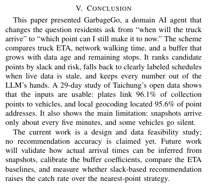
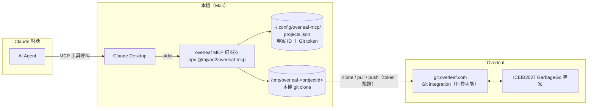
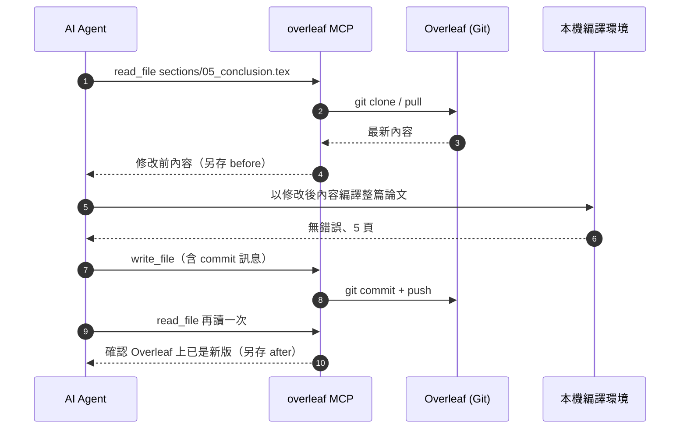

# Overleaf × MCP：用 AI Agent 直接編修 IEEE 會議論文

- **課程名稱**：AIoT 與數據分析（AIoT & Data Analytics, AIoT-DA）
- **回家作業**：DIC4 — 透過 MCP 讓 AI Agent 讀寫 Overleaf 論文
- **儲存庫網址**：https://github.com/anjyuelee/DIC4
- **論文**：GarbageGo: A Domain AI Agent for Time-Feasibility Recommendation of Garbage Collection Points Using Low-Frequency Open Data（ICEIB 2027 投稿稿，IEEEtran conference 格式）

在 Claude Desktop 安裝 Overleaf MCP 伺服器後，AI Agent 可以直接讀取 Overleaf 專案裡的 `.tex` 檔、改寫指定章節，並以 Git commit 推回 Overleaf。本儲存庫記錄一次實際的修改（Conclusion 章節）的修改前／後檔案與差異，以及 MCP 的安裝與設定方式。

## 修改前後

| 修改前 | 修改後 |
|---|---|
|  |  |

| | 修改前 | 修改後 |
|---|---|---|
| 完整 Overleaf 專案 | [`revision/before/`](revision/before/) | [`revision/after/`](revision/after/) |
| 整篇論文 PDF | [`revision/before/main.pdf`](revision/before/main.pdf) | [`revision/after/main.pdf`](revision/after/main.pdf) |
| 修改的章節 | [`before/sections/05_conclusion.tex`](revision/before/sections/05_conclusion.tex) | [`after/sections/05_conclusion.tex`](revision/after/sections/05_conclusion.tex) |

- 逐行差異：[`revision/05_conclusion.diff`](revision/05_conclusion.diff)（兩份專案只有 `sections/05_conclusion.tex` 不同）
- `revision/after/` 即目前 Overleaf 上的版本
- Overleaf commit 訊息：`Revise Conclusion: separate summary, limitations, and future work`

| 項目 | 修改前 | 修改後 |
|---|---|---|
| 段落結構 | 2 段（總結＋限制混在一起；未來工作） | 3 段：貢獻總結 → 研究限制 → 未來工作 |
| 方法總結 | 依序描述 slack、排序、退回時刻表 | 以「三個要素」串起：slack、資料過舊時退回時刻表、LLM 不產生數字 |
| 研究限制 | 一句帶過（5 分鐘快照、部分車輛失聯） | 獨立一段、分三點：快照頻率與 18% 失聯車輛、無實際到點真值、緩衝係數未校準（另補 4.4% 地址無座標） |
| 未來工作 | 列出四件事 | 每項對應一個限制，並寫出評估指標（MAE／RMSE、接到率、誤判率） |

修改只重組論文其他章節已有的事實與數字，沒有新增任何數據；推上 Overleaf 前先在本機編譯確認無錯誤、仍為 5 頁。

## 運作流程



### 一次修改的步驟



## 使用的 MCP

[mjyoo2/OverleafMCP](https://github.com/mjyoo2/OverleafMCP)（npm：`@mjyoo2/overleaf-mcp`），透過 Overleaf 的 Git integration 存取專案。

| 工具 | 用途 |
|---|---|
| `list_projects` | 列出設定好的專案 |
| `list_files` | 列出專案檔案（預設 `.tex`） |
| `read_file` | 讀取檔案 |
| `get_sections` | 列出 LaTeX 章節 |
| `get_section_content` | 讀取單一章節 |
| `status_summary` | 專案概況（檔案數、主檔） |
| `write_file` | 覆寫整個檔案並 commit、push |
| `write_section` | 只替換指定章節並 commit、push |

## 安裝與設定

### 前置條件

- **Overleaf 付費方案**：Git integration 是付費功能，專案擁有者沒有付費時，Overleaf 會回 `no git access`
- Node.js（含 `npx`）
- Claude Desktop

### 1. 取得 Overleaf 憑證

- **專案 ID**：專案網址 `https://www.overleaf.com/project/<這一段>`
- **Git token**：Overleaf → Account Settings → Git Integration → 建立 token（可存取帳號下所有專案，一年後過期；當密碼保管）

### 2. 建立 `projects.json`（token 放這裡，不寫進 Claude 設定檔）

```bash
mkdir -p ~/.config/overleaf-mcp
cp mcp/projects.example.json ~/.config/overleaf-mcp/projects.json
# 編輯檔案填入專案 ID 與 token
chmod 600 ~/.config/overleaf-mcp/projects.json
```

範本：[`mcp/projects.example.json`](mcp/projects.example.json)

### 3. 測試伺服器能否啟動

```bash
npx -y @mjyoo2/overleaf-mcp
```

stderr 出現 `Overleaf MCP server running on stdio` 即成功，按 Ctrl+C 結束。

### 4. 加入 Claude Desktop

先 ⌘Q 完全結束 Claude Desktop，再執行（自動找出本機 `npx` 路徑、先備份原設定檔）：

```bash
NPX=$(command -v npx); [ -z "$NPX" ] && echo "找不到 npx" || python3 - "$NPX" <<'EOF'
import json, os, shutil, sys
npx = sys.argv[1]
p = os.path.expanduser('~/Library/Application Support/Claude/claude_desktop_config.json')
shutil.copy(p, p + '.bak')
c = json.load(open(p))
c.setdefault('mcpServers', {})['overleaf'] = {
    "command": npx,
    "args": ["-y", "@mjyoo2/overleaf-mcp"],
    "env": {"PATH": os.path.dirname(npx) + ":/usr/local/bin:/usr/bin:/bin"}
}
json.dump(c, open(p, 'w'), indent=2, ensure_ascii=False)
print("已加入 overleaf →", npx)
EOF
```

完成後的設定長這樣：[`mcp/claude_desktop_config.example.json`](mcp/claude_desktop_config.example.json)。重新打開 Claude Desktop，🔧 選單出現 overleaf 即完成。

> `command` 用 `npx` 的完整路徑並另設 `PATH`：從 Dock 啟動的 App 讀不到 nvm 設定的 PATH，只寫 `"npx"` 常會啟動失敗。

## 踩過的坑

| 狀況 | 原因 | 解法 |
|---|---|---|
| `fatal: remote error: no git access` | 專案 ID 正確，但帳號是免費方案，沒有 Git integration | 升級付費方案（或使用學校的 Overleaf Commons 授權） |
| 設定檔找不到 `mcpServers` | Claude Desktop 重寫設定時拿掉了空的 `mcpServers` | 在最外層 `{` 下自行新增；用上面的 python 腳本最保險 |
| 用文字編輯改設定檔後 JSON 壞掉 | 文字編輯把 `"` 自動轉成彎引號 | 用貼上而非打字，或用腳本修改；存檔前 `python3 -m json.tool <檔案>` 檢查 |
| 改了設定但工具沒變 | Claude Desktop 只關視窗、沒有結束 | ⌘Q 完全結束後再開 |
| 改的是 A 電腦的設定，卻在 B 電腦測試 | 路徑（帳號名稱、nvm 版本）因電腦而異 | 每台電腦各自設定；腳本會自動抓該台的 `npx` 路徑 |
| 免費方案替代品 overleaf-web-mcp 用 Google 登入被擋 | Google 拒絕自動化控制的瀏覽器視窗 | 到 `overleaf.com/user/password/reset` 為帳號設密碼，改用 email＋密碼登入 |

## 專案結構

根目錄與 Overleaf 專案的檔案樹相同（目前 Overleaf 上的版本）；`revision/`、`mcp/`、`docs/` 是只放在 repo 的紀錄與設定。

```
DIC4/
├── README.md                      # 本說明（後半為 Overleaf 專案的 README）
├── main.tex                       # ┐
├── references.bib                 # │
├── sections/                      # │ 與 Overleaf 專案相同
│   └── 00_abstract … 05_conclusion.tex
├── figures/architecture.pdf       # │
├── tables/comparison.tex          # ┘
├── revision/
│   ├── before/                    # 修改前的完整 Overleaf 專案＋main.pdf
│   ├── after/                     # 修改後的完整 Overleaf 專案＋main.pdf（＝根目錄）
│   └── 05_conclusion.diff         # unified diff
├── mcp/
│   ├── claude_desktop_config.example.json  # Claude Desktop 設定範例（不含憑證）
│   └── projects.example.json               # Overleaf 專案／token 範本
└── docs/screenshots/              # 修改前後的 Conclusion 版面
```

## 本機編譯論文

需要 TeX Live（IEEEtran 在 `texlive-publishers` 套件內）：

```bash
latexmk -pdf main.tex            # 根目錄（目前版本）
cd revision/before && latexmk -pdf main.tex   # 修改前版本
```

## 安全注意事項

- `projects.json` 內含 Git token，已列入 `.gitignore`；本儲存庫只提交 `*.example.json`
- 每次 `write_file`／`write_section` 都會在 Overleaf 留下一個 Git commit，可從 Overleaf 的 History 還原

---

## 論文 LaTeX 專案說明（Overleaf 專案內的 README）

**GarbageGo: A Domain AI Agent for Time-Feasibility Recommendation of Garbage Collection Points Using Low-Frequency Open Data**

ICEIB 2027（7th International Conference on Electronic Communications, Internet of Things and Big Data）投稿用 LaTeX 專案，採 IEEEtran conference 版型。內容改寫自 GarbageGo repo 的 `docs/proposal/proposal-integrated.md`、`DESIGN.md` 與 `docs/research/` 實測報告。

- 全文篇幅：4–8 頁
- 摘要截止：2027/03/01
- 全文截止：2027/04/20（Important Dates 頁另列 final paper 2027/06/30，需向主辦單位確認）
- 注意：官網目前列的是 MDPI *Engineering Proceedings* (.docx) 模板，IEEE 格式是否適用請先與主辦單位確認

### 目錄結構

```
DIC4/（論文部分）
├── main.tex                 # 主檔：標題、作者、\input 各章節、參考文獻
├── references.bib           # BibTeX 參考文獻
├── README.md
├── sections/
│   ├── 00_abstract.tex      # 摘要 + IEEE Keywords
│   ├── 01_introduction.tex
│   ├── 02_related_work.tex
│   ├── 03_proposed_scheme.tex   # 架構、slack 公式、Algorithm 1、LLM 角色
│   ├── 04_experiments.tex   # 資料可行性實測 + 評估計畫（無推薦實驗結果）
│   └── 05_conclusion.tex
├── figures/
│   └── architecture.pdf     # 系統架構圖 ①–⑨（TikZ 繪製），可用同檔名覆蓋
└── tables/
    └── comparison.tex       # 與既有服務能力比較（Table I，由 02_related_work 引用）
```

### 編譯

**Overleaf**：上傳整個 zip（New Project → Upload Project），主檔設為 `main.tex`。IEEEtran 已內建。

**本機**（需 TeX Live，IEEEtran 在 `texlive-publishers` 套件內）：

```bash
latexmk -pdf main.tex
# 或
pdflatex main && bibtex main && pdflatex main && pdflatex main
```

清除暫存檔：`latexmk -c`

### 撰寫慣例

| 項目 | 規則 |
|---|---|
| 章節標籤 | `sec:intro` / `sec:related` / `sec:scheme` / `sec:exp` / `sec:conclusion` |
| 圖 | 放 `figures/`，以 `\figureorplaceholder{檔名}{\columnwidth}` 或 `\includegraphics` 引用；caption 在圖**下方**；引用寫 `Fig.~\ref{fig:xxx}` |
| 表 | 一張表一個檔放 `tables/`，在章節中 `\input{tables/xxx}`；caption 在表**上方**；引用寫 `Table~\ref{tab:xxx}` |
| 公式 | `\eqref{eq:xxx}`；符號在公式後立即定義 |
| 文獻 | `\cite{key}`，只有被引用的條目會出現在 References |
| 跨欄圖表 | 使用 `figure*` / `table*`，寬度 `\textwidth` |

### 新增圖片

1. 將圖檔（建議向量 PDF）放進 `figures/`
2. 在章節中：

```latex
\begin{figure}[htbp]
\centerline{\includegraphics[width=\columnwidth]{architecture.pdf}}
\caption{System architecture of the proposed scheme.}
\label{fig:arch}
\end{figure}
```

### 投稿前待辦（內容）

- [ ] 作者羅馬拼音、系所、Email（`main.tex`，目前只填了 An-Jyue Lee）
- [ ] 指導教授列為作者或寫在 Acknowledgment
- [ ] 確認 `safety_buffer` 的線性形式（式 2）組內是否同意——這是論文新增的形式化，`DESIGN.md` 尚未定義
- [ ] 推薦實驗完成後，補上 Results 小節（目前只有資料可行性與評估計畫）
- [ ] 確認 ICEIB 是否接受 IEEE 格式（官網列的是 MDPI Engineering Proceedings 模板）

### 投稿前檢查

- [ ] 頁數 4–8 頁
- [ ] 所有 `Missing figure` 佔位框都已替換
- [ ] 作者資訊、Acknowledgment 已填寫（雙盲審查則先移除）
- [ ] 編譯無 `??`（未解析的 `\ref` / `\cite`）
- [ ] 字型全部嵌入：`pdffonts main.pdf`，emb 欄皆為 `yes`
