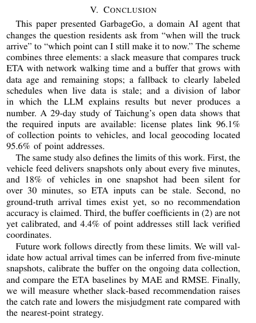
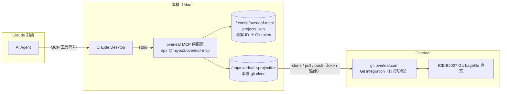
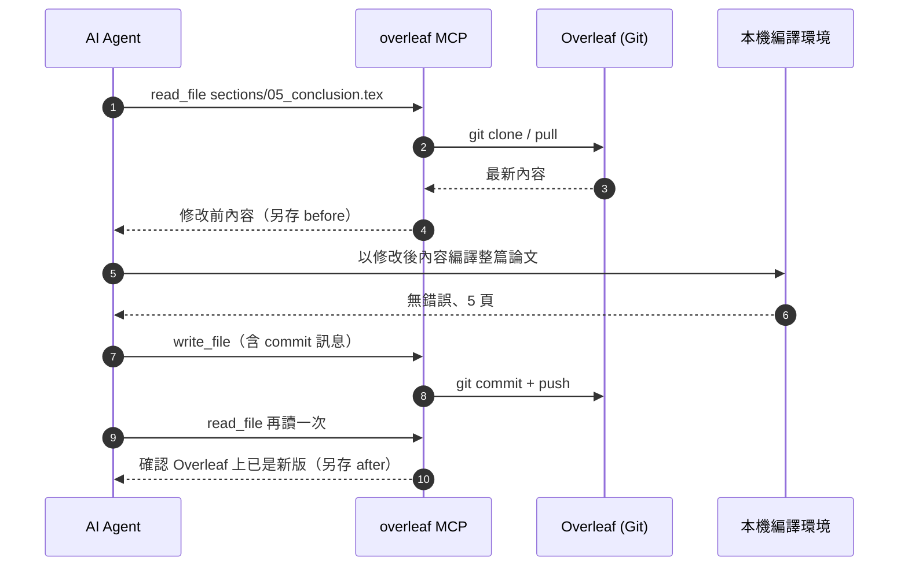

# Overleaf × MCP：用 AI Agent 直接編修 IEEE 會議論文

- **課程名稱**：AIoT 與數據分析（AIoT & Data Analytics, AIoT-DA）
- **回家作業**：DIC4 — 透過 MCP 讓 AI Agent 讀寫 Overleaf 論文
- **儲存庫網址**：https://github.com/anjyuelee/DIC4
- **論文**：GarbageGo: A Domain AI Agent for Time-Feasibility Recommendation of Garbage Collection Points Using Low-Frequency Open Data（ICEIB 2027 投稿稿，IEEEtran conference 格式）

在 Claude Desktop 安裝 Overleaf MCP 伺服器後，AI Agent 可以直接讀取 Overleaf 專案裡的 `.tex` 檔、改寫指定章節，並以 Git commit 推回 Overleaf。本儲存庫記錄一次實際的修改（Conclusion 章節）的修改前／後檔案與差異，以及 MCP 的安裝與設定方式。

## 修改前後

| 修改前 | 修改後 |
|---|---|
|  |  |

- 原始檔：[`revision/before/sections/05_conclusion.tex`](revision/before/sections/05_conclusion.tex) → [`revision/after/sections/05_conclusion.tex`](revision/after/sections/05_conclusion.tex)
- 逐行差異：[`revision/05_conclusion.diff`](revision/05_conclusion.diff)
- Overleaf commit 訊息：`Revise Conclusion: separate summary, limitations, and future work`

| 項目 | 修改前 | 修改後 |
|---|---|---|
| 段落結構 | 2 段（總結＋限制混在一起；未來工作） | 3 段：貢獻總結 → 研究限制 → 未來工作 |
| 方法總結 | 依序描述 slack、排序、退回時刻表 | 以「三個要素」串起：slack、資料過舊時退回時刻表、LLM 不產生數字 |
| 研究限制 | 一句帶過（5 分鐘快照、部分車輛失聯） | 獨立一段、分三點：快照頻率與 18% 失聯車輛、無實際到點真值、緩衝係數未校準（另補 4.4% 地址無座標） |
| 未來工作 | 列出四件事 | 每項對應一個限制，並寫出評估指標（MAE／RMSE、接到率、誤判率） |

修改只重組論文其他章節已有的事實與數字，沒有新增任何數據；推上 Overleaf 前先在本機編譯確認無錯誤、仍為 5 頁。

## 運作流程



### 一次修改的步驟



## 使用的 MCP

[mjyoo2/OverleafMCP](https://github.com/mjyoo2/OverleafMCP)（npm：`@mjyoo2/overleaf-mcp`），透過 Overleaf 的 Git integration 存取專案。

| 工具 | 用途 |
|---|---|
| `list_projects` | 列出設定好的專案 |
| `list_files` | 列出專案檔案（預設 `.tex`） |
| `read_file` | 讀取檔案 |
| `get_sections` | 列出 LaTeX 章節 |
| `get_section_content` | 讀取單一章節 |
| `status_summary` | 專案概況（檔案數、主檔） |
| `write_file` | 覆寫整個檔案並 commit、push |
| `write_section` | 只替換指定章節並 commit、push |

## 安裝與設定

### 前置條件

- **Overleaf 付費方案**：Git integration 是付費功能，專案擁有者沒有付費時，Overleaf 會回 `no git access`
- Node.js（含 `npx`）
- Claude Desktop

### 1. 取得 Overleaf 憑證

- **專案 ID**：專案網址 `https://www.overleaf.com/project/<這一段>`
- **Git token**：Overleaf → Account Settings → Git Integration → 建立 token（可存取帳號下所有專案，一年後過期；當密碼保管）

### 2. 建立 `projects.json`（token 放這裡，不寫進 Claude 設定檔）

```bash
mkdir -p ~/.config/overleaf-mcp
cp mcp/projects.example.json ~/.config/overleaf-mcp/projects.json
# 編輯檔案填入專案 ID 與 token
chmod 600 ~/.config/overleaf-mcp/projects.json
```

範本：[`mcp/projects.example.json`](mcp/projects.example.json)

### 3. 測試伺服器能否啟動

```bash
npx -y @mjyoo2/overleaf-mcp
```

stderr 出現 `Overleaf MCP server running on stdio` 即成功，按 Ctrl+C 結束。

### 4. 加入 Claude Desktop

先 ⌘Q 完全結束 Claude Desktop，再執行（自動找出本機 `npx` 路徑、先備份原設定檔）：

```bash
NPX=$(command -v npx); [ -z "$NPX" ] && echo "找不到 npx" || python3 - "$NPX" <<'EOF'
import json, os, shutil, sys
npx = sys.argv[1]
p = os.path.expanduser('~/Library/Application Support/Claude/claude_desktop_config.json')
shutil.copy(p, p + '.bak')
c = json.load(open(p))
c.setdefault('mcpServers', {})['overleaf'] = {
    "command": npx,
    "args": ["-y", "@mjyoo2/overleaf-mcp"],
    "env": {"PATH": os.path.dirname(npx) + ":/usr/local/bin:/usr/bin:/bin"}
}
json.dump(c, open(p, 'w'), indent=2, ensure_ascii=False)
print("已加入 overleaf →", npx)
EOF
```

完成後的設定長這樣：[`mcp/claude_desktop_config.example.json`](mcp/claude_desktop_config.example.json)。重新打開 Claude Desktop，🔧 選單出現 overleaf 即完成。

> `command` 用 `npx` 的完整路徑並另設 `PATH`：從 Dock 啟動的 App 讀不到 nvm 設定的 PATH，只寫 `"npx"` 常會啟動失敗。

## 踩過的坑

| 狀況 | 原因 | 解法 |
|---|---|---|
| `fatal: remote error: no git access` | 專案 ID 正確，但帳號是免費方案，沒有 Git integration | 升級付費方案（或使用學校的 Overleaf Commons 授權） |
| 設定檔找不到 `mcpServers` | Claude Desktop 重寫設定時拿掉了空的 `mcpServers` | 在最外層 `{` 下自行新增；用上面的 python 腳本最保險 |
| 用文字編輯改設定檔後 JSON 壞掉 | 文字編輯把 `"` 自動轉成彎引號 | 用貼上而非打字，或用腳本修改；存檔前 `python3 -m json.tool <檔案>` 檢查 |
| 改了設定但工具沒變 | Claude Desktop 只關視窗、沒有結束 | ⌘Q 完全結束後再開 |
| 改的是 A 電腦的設定，卻在 B 電腦測試 | 路徑（帳號名稱、nvm 版本）因電腦而異 | 每台電腦各自設定；腳本會自動抓該台的 `npx` 路徑 |
| 免費方案替代品 overleaf-web-mcp 用 Google 登入被擋 | Google 拒絕自動化控制的瀏覽器視窗 | 到 `overleaf.com/user/password/reset` 為帳號設密碼，改用 email＋密碼登入 |

## 專案結構

```
DIC4/
├── README.md
├── paper/                         # 論文 LaTeX 專案（與 Overleaf 同步，為修改後版本）
│   ├── main.tex
│   ├── references.bib
│   ├── sections/                  # 00_abstract … 05_conclusion
│   ├── figures/architecture.pdf
│   └── tables/comparison.tex
├── revision/
│   ├── before/sections/05_conclusion.tex   # 修改前
│   ├── after/sections/05_conclusion.tex    # 修改後
│   └── 05_conclusion.diff                  # unified diff
├── mcp/
│   ├── claude_desktop_config.example.json  # Claude Desktop 設定範例（不含憑證）
│   └── projects.example.json               # Overleaf 專案／token 範本
└── docs/screenshots/              # 修改前後的 Conclusion 版面
```

## 本機編譯論文

需要 TeX Live（IEEEtran 在 `texlive-publishers` 套件內）：

```bash
cd paper
latexmk -pdf main.tex
```

## 安全注意事項

- `projects.json` 內含 Git token，已列入 `.gitignore`；本儲存庫只提交 `*.example.json`
- 每次 `write_file`／`write_section` 都會在 Overleaf 留下一個 Git commit，可從 Overleaf 的 History 還原
